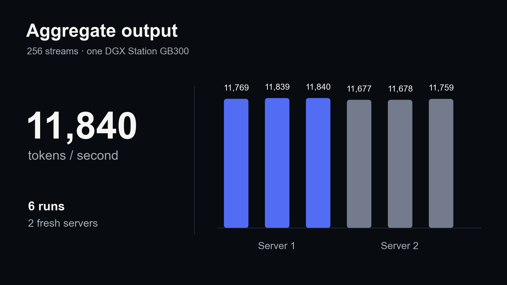

# Nemotron 3.5 Super VL: 11.8K output tok/s on one DGX Station GB300

[Explore the design gallery](https://arafatkatze.github.io/nemotron-3.5-gb300-recipes/) — four artifacts in eight visual styles, with PNG/SVG downloads. The self-contained [HTML file](index.html) also works offline. Rebuild it with `python3 scripts/build_design_gallery.py`.

Open recipes, benchmark code, synthetic quality cases, measured summaries, and editable figures. The experiment used stock vLLM and NVIDIA's documented FP16 recurrent-state/stochastic-rounding recipe. No custom runtime patches, overclocking, or model weights are included.

**11,677–11,840 aggregate output tokens/sec** over local streaming HTTP at 256 concurrent requests, in six repetitions across two fresh server instances. Each request used exactly 512 input and 512 generated output tokens. Output includes native reasoning and final-answer tokens. This is aggregate output, not the speed of one user.



## Results

| Configuration | C128 output tok/s | C256 output tok/s |
|---|---:|---:|
| Reasoning-enabled FP32 recurrent-state control | 7,932–7,962 | 9,664–9,766 |
| FP16 state + stochastic rounding, instance1 | 9,165–9,187 | 11,769–11,840 |
| Same recipe, fresh instance2 | Not repeated | 11,677–11,759 |

Pooling total tokens / total elapsed time over the matched initial three-run comparison gives 9,712→11,816 tok/s at C256: **+21.7%**. Across all six qualifying C256 runs, pooled throughput is 11,760 tok/s.

Both qualifying instances passed 23 fixed numerical/code/retrieval cases repeated 3 times (69 observations), plus 6 smoke checks. The fresh instance also passed 256/256 unique request identity checks, with peak client in-flight 256. Timed requests have exact token counts, nonempty output and simple degeneracy checks; generated tutorials are not independently fact-graded. This bounded suite does not establish universal accuracy or parity with a different quantization.

Separate 8K-input/128-output probes measured 0.173 s and 0.179 s to first streamed text, one probe per instance. At C256 with 512-token inputs, median TTFT was 1.91–2.00 s. Latest single-stream decode was 390–398 tok/s; the earlier 540.7 tok/s Triton/MTP3 result belongs to a different configuration with a smaller 20-check suite.

## Comparison scope

The published [Actual case study](https://actual.inc/company/blog/case-study-dgx-station-and-nemotron-3-5-super-vl) reports FP8 weights and 1M configured context. Our run uses **NVFP4 weights and16,384 configured context**, text-only. Actual's exact throughput workload is undisclosed. Exceeding the 10,500 numerical target is **not a matched-workload reproduction or an all-metrics victory**.

## Hardware and pins

- One DGX Station GB300: a single NVIDIA GB300 with approximately 288 GB HBM. The measured Docker recipe uses a 360 GB host-memory limit; match the Station-class host resources as well as the GPU. This is an ARM64 image, not an interchangeable x86 release.
- NVIDIA Container Toolkit, Docker and a compatible Blackwell driver; enough free GPU memory for one exclusive serving workload. This recipe does not stop any existing service.
- Downloaded weights: 75,010,188,240 bytes across 88 shards, excluding ancillary files. Reserve additional disk for the image, model and compilation cache.
- Model: [`nvidia/NVIDIA-Nemotron-3.5-Super-VL-120B-A12B-NVFP4`](https://huggingface.co/nvidia/NVIDIA-Nemotron-3.5-Super-VL-120B-A12B-NVFP4), revision`2e5cc3953bb1ea66b2fb7c831fee3aa317427e69`.
- Image:`vllm/vllm-openai@sha256:fd33bec1578f312a01547cc6b9691a5154c3e8bcfb76d2b35acb657bfc4eee8f`.
- vLLM:`0.32.0rc1.dev190+g3f1bcfd82`, source`3f1bcfd82bb2e93fcd364fc7a5491718453a77e2`.

## Reproduce

Run on the target ARM64 Station. No automatic GPU run or download occurs when cloning.

```bash
git clone https://github.com/arafatkatze/nemotron-3.5-gb300-recipes.git
cd nemotron-3.5-gb300-recipes
python3 -m pip install -r requirements.txt
python3 scripts/download_model.py
bash scripts/start.sh control --dry-run
bash scripts/start.sh control
```

Wait until`curl --fail http://127.0.0.1:8015/health` succeeds. The image can spend several minutes compiling/capturing graphs. Inspect progress with`docker logs nemotron35-recipes`.

```bash
# Baseline quality reference and repeated control timings.
docker exec nemotron35-recipes python3 /recipe/benchmark.py \
  --arm control --output /results/control

# Stop/remove only the recipe container before changing its configuration.
docker stop nemotron35-recipes
docker rm nemotron35-recipes
bash scripts/start.sh candidate
# Wait for /health again.
docker exec nemotron35-recipes python3 /recipe/benchmark.py \
  --arm candidate --output /results/candidate \
  --reference /results/control/control-quality-reference.json

# Repeat on a fresh server, retaining the same control reference.
docker stop nemotron35-recipes
docker rm nemotron35-recipes
bash scripts/start.sh candidate
# Wait for /health again.
docker exec nemotron35-recipes python3 /recipe/benchmark.py \
  --arm confirmation --output /results/confirmation \
  --reference /results/control/control-quality-reference.json \
  --concurrencies 256 --check-integrity

# Explicit cleanup; downloaded weights and evidence remain on disk.
docker stop nemotron35-recipes
docker rm nemotron35-recipes
```

`MODEL_PATH`, `RESULTS_PATH`, and`CONTAINER_NAME` override local paths/name in the launcher. If changing the container name, use that same exact name in subsequent Docker commands. The host endpoint is bound to loopback. There is no authentication layer for exposing it externally.

## What the benchmark measures

- Tokenizer uses the pinned native chat template with reasoning enabled; token IDs freeze the input to 512 tokens and retain the tail instruction. Greedy sampling, seed 1234, ignore EOS for exactly 512 output tokens.
- Quality responses can use 2048 output tokens. The six smoke checks and 23 numerical/code/retrieval cases must pass; candidate comparison additionally rejects any newly failing reference observation.
- Each concurrency gets a same-shape warmup excluded from timing. Native MTP1, FlashInfer Mamba, CUDA graphs, async scheduling, OMP=1, FP8 KV, and prefix caching disabled in both arms.
- Aggregate output tok/s = total returned completion tokens / wall time from shared batch release to last completion, including prefill and local HTTP/client overhead. Common-decode rate is separately retained in evidence; do not substitute it for the HTTP headline.
- Client overlap establishes simultaneous requests, not 256 independent GPU kernels.
- Per-request synthetic prompts, responses and timings are saved locally in ignored`runs/`. Original campaign raw synthetic results are distributed separately under `evidence/campaign/`, alongside the selected summaries.

## Artifacts and provenance

- [`evidence/campaign/`](evidence/campaign/): original measured benchmark sources, all available trial summaries, raw synthetic per-request outputs/timings, quality responses, rejected-trial evidence and independent restoration checks; hash-indexed and compressed where useful.

- [`evidence/measurements.json`](evidence/measurements.json): original campaign summary snapshots, including earlier single-stream probe.
- [`evidence/derived-metrics.json`](evidence/derived-metrics.json): pooled-throughput calculations.
- [`evidence/model-manifest.json`](evidence/model-manifest.json): SHA256 and byte counts for the pinned model files; no weights redistributed.
- [`evidence/provenance.json`](evidence/provenance.json): measured benchmark source hash and packaging changes.
- [`figures/`](figures/): three PNGs and editable SVGs, ready for a CMS, Notion or HTML.
- [`figures/captions.md`](figures/captions.md): conditions kept outside the images; [`figures/light/`](figures/light/) contains warm light alternatives. PNGs are 1920 × 1080.
- `python3 render_figures.py`: regenerate the figures from the distributed summaries.

The original measured campaign scripts were adapted to accept portable CLI paths, remove environment-specific prose-reference dependencies, require all 69 observations to pass and expose the confirmation integrity check. Packaging checks validate syntax, CLI behavior and deterministic figure regeneration; the portable release was not rerun on a GPU. Original campaign measurements and fresh-server confirmation are retained separately and are not described as new packaging measurements.

## License

Recipe code and original figures/data in this repository: **MIT**. NVIDIA model weights are downloaded separately and retain the license and terms on their model card. vLLM and container dependencies retain their own licenses. This release does not relicense third-party software or redistribute weights.
