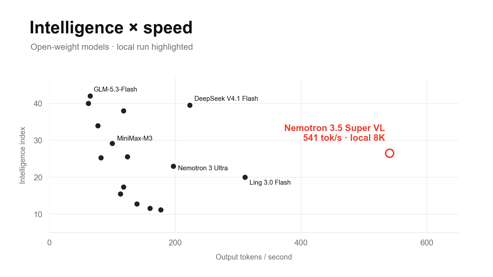

# Nemotron 3.5 Super VL on GB300

**11.8K aggregate output tok/s on one DGX Station GB300.** A pinned vLLM recipe with native MTP, FlashInfer and FP16 recurrent state with stochastic rounding.

## Run

Requires an **ARM64 DGX Station GB300**, Docker with NVIDIA Container Toolkit, a compatible driver, and an idle GPU. The container uses a 360 GB host-memory limit; the pinned weights are approximately 75 GB.

```bash
git clone https://github.com/arafatkatze/nemotron-3.5-gb300-recipes.git
cd nemotron-3.5-gb300-recipes
python3 -m venv .venv
source .venv/bin/activate
python3 -m pip install -r requirements.txt

# Download the pinned checkpoint and verify its SHA256 manifest.
python3 scripts/download_model.py

# Start the optimized server.
bash scripts/start.sh candidate
```

Wait for `curl -fsS http://127.0.0.1:8015/health` to succeed. Initial compilation and CUDA graph capture take several minutes; follow progress with `docker logs -f nemotron35-recipes`.

```bash
curl -N http://127.0.0.1:8015/v1/chat/completions \
  -H 'Content-Type: application/json' \
  -d '{
    "model": "nemotron-3.5-super-vl",
    "messages": [{"role": "user", "content": "Explain how a retry queue works."}],
    "max_tokens": 2048,
    "temperature": 0,
    "stream": true,
    "chat_template_kwargs": {"enable_thinking": true}
  }'
```

## The recipe

| Setting | Value |
|---|---|
| Weights / KV cache | NVFP4 / FP8 |
| Recurrent state | FP16 + stochastic rounding, Philox5 |
| Speculative decoding | Native MTP, 1 token |
| Scheduling / Mamba | Async / FlashInfer |
| CPU threads | `OMP_NUM_THREADS=1` |
| Context / concurrent sequences | 16,384 / 256 |
| Batched tokens / GPU memory utilization | 8,192 / 0.80 |
| Prefix caching | Off |

The model revision and ARM64 image digest are pinned in the [downloader](scripts/download_model.py) and [launcher](scripts/start.sh). Preview the exact command with `bash scripts/start.sh candidate --dry-run`. Set `MODEL_PATH`, `RESULTS_PATH` or `CONTAINER_NAME` to override their defaults.

## Verify throughput

With the server ready:

```bash
docker exec nemotron35-recipes python3 /recipe/benchmark.py \
  --arm candidate --output /results/candidate \
  --concurrencies 256 --repeats 3 --check-integrity
```

Results are written to `runs/candidate/`. The benchmark runs correctness checks, 256 simultaneous identity checks, warmup, three timed batches and a separate 8K-input latency probe.

**Measured: 11,677–11,840 output tok/s**, six runs across two server instances, each with 256 requests × 512 input / 512 output tokens. Both instances passed 69/69 fixed correctness observations. Output includes reasoning tokens. These measurements use NVFP4 weights and 16K configured context; they are not a matched reproduction of the published FP8 / 1M-context result.

[Full benchmark, control comparison and pins](docs/BENCHMARK.md) · [Raw results and original scripts](evidence/campaign/)



*Chart reference points are visually estimated; reference speeds use 100K input versus local 8K. The highlighted intelligence score was not measured on this local configuration.*

## Stop

```bash
docker stop nemotron35-recipes
docker rm nemotron35-recipes
```

Use your chosen container name if overridden. Downloaded weights, compilation cache and results remain on disk. The API binds to localhost.

[MIT](LICENSE) for the recipe code. Model weights are downloaded separately under NVIDIA’s model terms.
